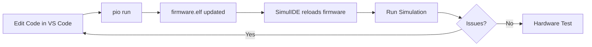

# SimulIDE Simulation for Rover-Drone Project

SimulIDE is a real-time electronic circuit simulator that supports:
- TB6612FNG motor driver
- DC motors with encoder feedback
- HC-SR04 ultrasonic sensors
- MPU6050 IMU (I2C)
- IR reflectance sensors (line following)
- ESP32 (via compiled firmware)

## 🚀 Quick Start

### 1. Install SimulIDE
```bash
# Ubuntu/Debian
sudo apt install simulide

# Or download AppImage from https://simulide.org/
wget https://github.com/SimulIDE/SimulIDE/releases/download/v1.1.0/SimulIDE_1.1.0-Linux.tar.gz
tar -xzf SimulIDE_1.1.0-Linux.tar.gz
./SimulIDE_1.1.0/bin/simulide
```

### 2. Build Firmware
```bash
cd ../../firmware
pio run
```
Produces: `.pio/build/esp32dev/firmware.elf` (for SimulIDE)

### 3. Open Project
1. Launch SimulIDE
2. **File → Open** → select `rover_simulation.simu` (this folder)
3. Or create new circuit using components below

## 🔧 Circuit Components (Option B Pinout)

| Component | SimulIDE Part | Key Properties |
|-----------|---------------|----------------|
| ESP32 | **Microcontroller → ESP32** | Load `firmware.elf` |
| TB6612FNG | **IC → Motor Driver → TB6612FNG** | - |
| DC Motor L/R | **Electromechanical → DC Motor** | - |
| Encoder L/R | **Sensors → Rotary Encoder** | Pulses/rev: 20 |
| HC-SR04 (x2) | **Sensors → Ultrasonic → HC-SR04** | - |
| MPU6050 | **Sensors → IMU → MPU6050** | I2C Address: 0x68 |
| Line Sensors (x4) | **Sensors → IR Reflectance** | - |
| Battery | **Sources → Battery** | 7.4V |
| Buck Converter | **Power → DC-DC Converter** | 5V Out |
| Voltage Divider | **Passive → Resistor** | 210k/10k (21:1) |

## 📐 Wiring (Match Option B Pinout)

### ESP32 Pinout (38-pin DevKitC V1)
```
Left Side (top to bottom):     Right Side (top to bottom):
3V3, EN, VP, VN, 34, 35, 36, 39,  25, 26, 27, 14, 12, 13, GND, 5V
GND, 23, 22, 21, 19, 18, 5,  4,   0,  2,  15,  13,  16,  17
```

### Key Connections
| Function | ESP32 GPIO | Component Pin |
|----------|------------|---------------|
| Motor STBY | 4 | TB6612FNG STBY |
| Motor AIN1 | 5 | TB6612FNG AIN1 |
| Motor AIN2 | 18 | TB6612FNG AIN2 |
| Motor PWMA | 19 | TB6612FNG PWMA |
| Motor BIN1 | 21 | TB6612FNG BIN1 |
| Motor BIN2 | 22 | TB6612FNG BIN2 |
| Motor PWMB | 23 | TB6612FNG PWMB |
| Encoder LA | 14 | Encoder L A |
| Encoder LB | 25 | Encoder L B |
| Encoder RA | 26 | Encoder R A |
| Encoder RB | 27 | Encoder R B |
| US Front Trig | 13 | HC-SR04 Front Trig |
| US Front Echo | 12 | HC-SR04 Front Echo |
| US Rear Trig | 2 | HC-SR04 Rear Trig |
| US Rear Echo | 15 | HC-SR04 Rear Echo |
| I2C SDA | 16 | MPU6050 SDA |
| I2C SCL | 17 | MPU6050 SCL |
| Line L2 | 36 | IR Sensor L2 OUT |
| Line L1 | 39 (VN) | IR Sensor L1 OUT |
| Line R1 | 34 | IR Sensor R1 OUT |
| Line R2 | 35 | IR Sensor R2 OUT |
| Battery ADC | 33 | Voltage Divider Out |
| Buzzer | 32 | Buzzer + |
| Emergency Stop | 3 | Pushbutton (pull-up) |

## 🔋 Power Circuit
```
2S Li-ion (7.4V) → Battery Holder → TB6612FNG VM (motor power)
                → XL4015 Buck IN → 5V Out → ESP32 5V Pin
                                       → TB6612FNG VCC (logic)
                                       → HC-SR04 VCC (x2)
                                       → Sensors VCC
                → Voltage Divider (210k/10k = 21:1) → ESP32 GPIO 33
ALL GNDs CONNECTED (star ground)
```

## ⚙️ Simulation Settings

### ESP32 Configuration
1. Right-click ESP32 → **Properties**
2. **Firmware**: Select `../../firmware/.pio/build/esp32dev/firmware.elf`
3. **Clock**: 240 MHz

### Simulation Speed
- **Toolbar** → Speed slider: 1x (real-time) to 1000x
- For motor testing: 10-50x
- For sensor logic: 1x

### Oscilloscope/Logic Analyzer
- **Tools → Oscilloscope** → Add channels for PWM pins (19, 23)
- **Tools → Logic Analyzer** → Add channels for encoder pins (14, 26), I2C (16, 17)

## 🧪 Test Scenarios

### 1. Boot Test
- Run simulation → Serial Monitor (Tools → Serial Monitor, 115200 baud)
- Verify: "MPU6050 connected OK", "AP Started", "Core 0 started"

### 2. Motor PWM Test
- Logic Analyzer on pins 19, 23
- Send WS command via simulated network or Serial injection
- Verify PWM frequency 20kHz, duty cycle changes

### 3. Encoder Feedback
- Logic Analyzer on pins 14, 26
- Rotate motor in sim → verify pulses
- Check speed calculation in firmware

### 4. Sensor Simulation
- **HC-SR04**: Set distance property in properties panel
- **MPU6050**: Set orientation/acceleration in properties
- **Line Sensors**: Toggle "reflectance" property (0-100%)

### 5. Battery Monitor
- Adjust battery voltage (7.4V → 6.0V)
- Verify ADC reading on GPIO 33
- Check low-battery warning at 7.0V

## 🐛 Debugging Tips

| Issue | Solution |
|-------|----------|
| ESP32 not running | Check firmware.elf path, clock speed |
| Motor not moving | Verify TB6612FNG STBY=HIGH, VM powered |
| Encoder no pulses | Check encoder attached to motor shaft in sim |
| I2C not working | Verify MPU6050 address 0x68, pull-ups on SDA/SCL |
| ADC wrong | Check voltage divider ratio (21:1) |
| Slow simulation | Reduce speed, close unused scopes |

## 📁 Project Files

```
simulator/simulide/
├── README.md           # This file
├── rover_simulation.simu    # Main circuit file (create in SimulIDE)
├── components.md       # Component reference
└── wiring.md          # Detailed wiring guide
```

## 🔄 Workflow



## 📚 References

- [SimulIDE Manual](https://simulide.org/wiki/)
- [SimulIDE ESP32 Guide](https://simulide.org/wiki/esp32)
- [TB6612FNG in SimulIDE](https://simulide.org/wiki/tb6612fng)
- [ESP32 Pinout](https://docs.espressif.com/projects/esp-idf/en/latest/esp32/hw-reference/esp32/get-started-devkitc.html)

---

**Next:** Create circuit in SimulIDE → Save as `rover_simulation.simu` → Test!
