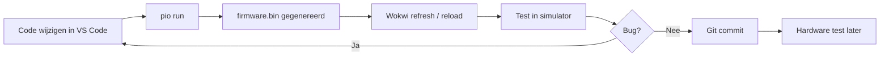

# Wokwi Simulator voor Rover-Drone Project

Deze map bevat de Wokwi configuratie om de rover firmware **virtueel te testen** voordat de hardware aankomt.

## 🚀 Quick Start

### 1. Firmware Bouwen
```bash
cd ../../firmware
pio run
```
Dit produceert: `.pio/build/esp32dev/firmware.bin`

### 2. Wokwi Openen
**Optie A: Via Browser (aanbevolen)**
1. Ga naar https://wokwi.com/projects/new/esp32
2. Klik op "Load Project" → selecteer `diagram.json` uit deze map
3. Klik op het firmware icoon (📁) → selecteer `../../firmware/.pio/build/esp32dev/firmware.bin`
4. Druk op **Play** (▶️)

**Optie B: Wokwi CLI (voor automatisering)**
```bash
# Installeer Wokwi CLI
npm install -g @wokwi/cli

# Run simulatie
wokwi run --firmware ../../firmware/.pio/build/esp32dev/firmware.bin diagram.json
```

## 🔌 Pinout (Option B - مطابقt met hardware)

| Component | Wokwi Part | GPIO | Type |
|-----------|------------|------|------|
| **Motor Driver (TB6612FNG)** | `tb6612fng` | | |
| STBY | | 4 | Output |
| AIN1 (L dir) | | 5 | Output |
| AIN2 (L dir) | | 18 | Output |
| PWMA (L PWM) | | 19 | LEDc Ch 0 |
| BIN1 (R dir) | | 21 | Output |
| BIN2 (R dir) | | 22 | Output |
| PWMB (R PWM) | | 23 | LEDc Ch 1 |
| **Motor L + Encoder** | `dc-motor` + `encoder` | | |
| Enc A (speed) | | 14 | Input + Interrupt |
| Enc B (dir) | | 25 | Input + Interrupt |
| **Motor R + Encoder** | `dc-motor` + `encoder` | | |
| Enc A (speed) | | 26 | Input + Interrupt |
| Enc B (dir) | | 27 | Input + Interrupt |
| **HC-SR04 Front** | `hc-sr04` | Trig=13, Echo=12 | |
| **HC-SR04 Rear** | `hc-sr04` | Trig=2, Echo=15 | |
| **MPU6050 (Wire1)** | `mpu6050` | SDA=16, SCL=17 | I2C 0x68 |
| **Line Sensors (ADC1)** | `ir-reflectance-sensor` | | |
| L2 (linksbuiten) | | 36 | ADC1_CH0 |
| L1 (linksbinnen) | | 39 (VN) | ADC1_CH3 |
| R1 (rechtsbinnen) | | 34 | ADC1_CH6 |
| R2 (rechtsbuiten) | | 35 | ADC1_CH7 |
| **Battery Sim** | `voltage-source` | 33 | ADC1_CH5 |
| **Emergency Stop** | `pushbutton` | 3 | Input Pull-up, Active LOW |
| **Buzzer** | `buzzer` | 32 | Output |
| **Status LED** | Onboard | 2 | Output |

## 🧪 Test Scenario's

### Handmatig in Wokwi:
1. **Boot Test** — Seriële monitor openen (115200 baud), check:
   ```
   === ESP32 ROVER STARTING ===
   MPU6050 connected OK
   AP Started: Rover_AP (IP: 192.168.4.1)
   HTTP + WS Server started
   Core 0: Real-time loop started (1kHz)
   ```

2. **Motor Test** — Seriële monitor:
   - In Wokwi: `Serial.println()` output volgen
   - Of: Logic Analyzer op D19/D23 (PWM) bekijken

3. **Encoder Test** — Logic Analyzer op D14/D26 (Enc A pulsen)

4. **Sensor Test** — Seriële plotter op D36, VN, D34, D35 (lijn sensoren)

5. **Battery Test** — Voltage source aanpassen (7.4V → 6.0V) → low-batt alarm check

6. **Emergency Stop** — Pushbutton indrukken → motoren moeten direct stoppen

7. **WebSocket Test** — Externe client verbinden met Wokwi's virtuele IP

### Geautomatiseerd (Wokwi CLI + Script):
```bash
# Voorbeeld test script
wokwi run --firmware ../../firmware/.pio/build/esp32dev/firmware.bin diagram.json \
  --timeout 30s \
  --expect-serial "MPU6050 connected OK" \
  --expect-serial "AP Started"
```

## 🐛 Debuggen in Wokwi

| Tool | Hoe te gebruiken |
|------|------------------|
| **Seriële Monitor** | 115200 baud, alle `Serial.print()` output |
| **Logic Analyzer** | Klik op pin → "Add to Logic Analyzer" → timing diagram |
| **Serial Plotter** | Tools → Serial Plotter → grafieken van sensor waarden |
| **Variable Watch** | Niet direct, maar via `Serial.printf("var=%d\n", var)` |
| **Breakpoints** | Niet ondersteund (simulator), gebruik printf debugging |

## 🔄 Workflow voor Ontwikkeling



## 📝 Tips voor Kinderen

1. **Visueel leren:** In Wokwi zien ze de draden "lopen" — helpt begrijpen wat er op breadboard moet
2. **Veilig experimenteren:** "Wat als ik deze pin verander?" → direct resultaat, geen rook
3. **Debuggen leren:** Logic Analyzer = "oscoop voor beginners" — timing zichtbaar maken
4. **Samenwerken:** Wokwi project delen via link → samen kijken op 2 schermen

## ⚠️ Bekende Limitaties

| Limitatie | Workaround |
|-----------|------------|
| Geen echte motor last | Encoder simulatie is ideaal (geen wrijving) |
| WiFi AP in Wokwi is virtueel | Externe client kan niet direct connecten zonder Wokwi Gateway |
| Geen echte I2C timing issues | MPU6050 gedraagt zich perfect |
| ADC ruis niet gesimuleerd | Lijnsensor waarden zijn clean |

## 📚 Referenties

- [Wokwi ESP32 Guide](https://docs.wokwi.com/parts/esp32)
- [Wokwi TB6612FNG](https://docs.wokwi.com/parts/wokwi-tb6612fng)
- [Wokwi HC-SR04](https://docs.wokwi.com/parts/wokwi-hc-sr04)
- [Wokwi MPU6050](https://docs.wokwi.com/parts/wokwi-mpu6050)
- [Wokwi IR Reflectance](https://docs.wokwi.com/parts/wokwi-ir-reflectance-sensor)
- [Wokwi Encoder](https://docs.wokwi.com/parts/wokwi-encoder)
- [Wokwi DC Motor](https://docs.wokwi.com/parts/wokwi-dc-motor)

---

**Volgende stap:** Na hardware aankomst → fysieke wiring vergelijken met `diagram.json` → firmware flashen op echte ESP32!
